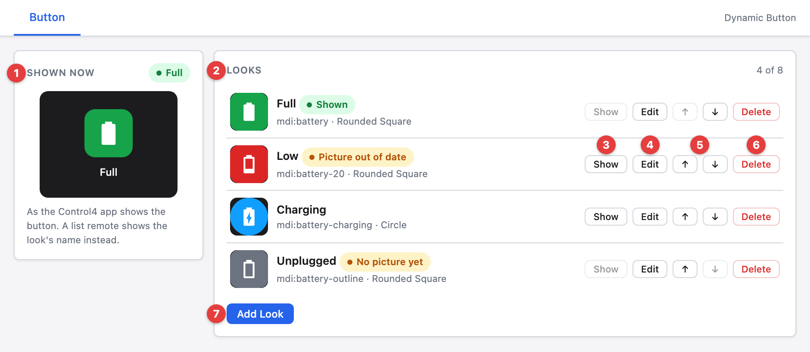
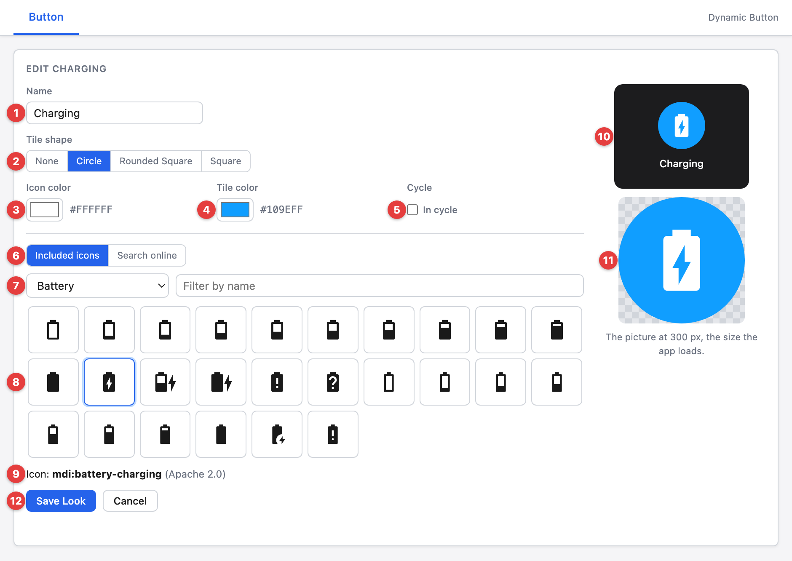
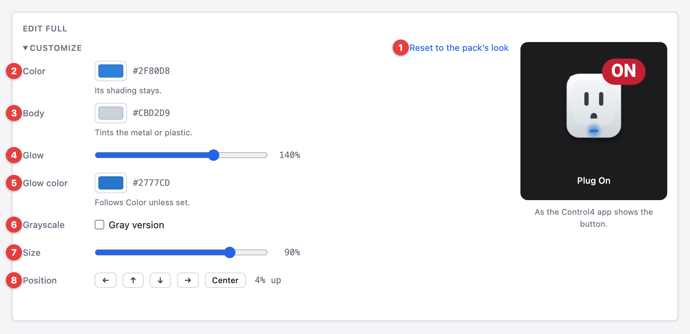
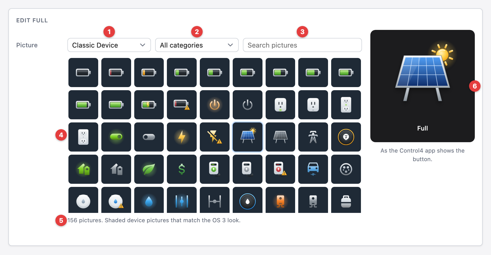
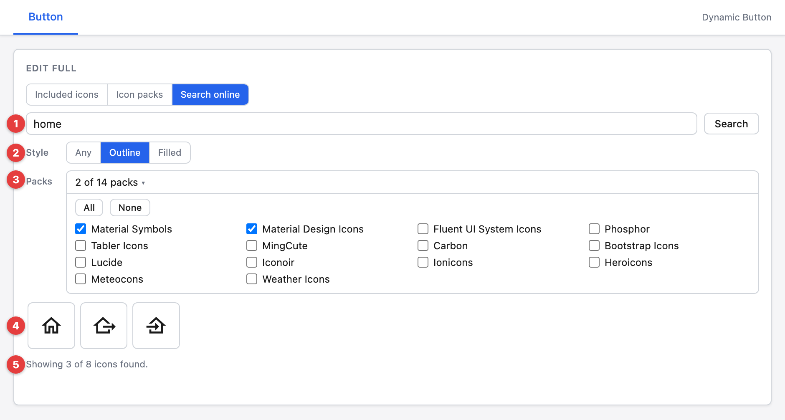
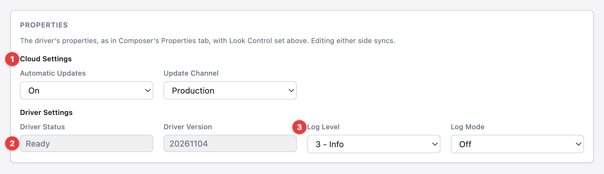

<!-- Copyright 2026 Finite Labs, LLC. All rights reserved. -->

______________________________________________________________________

# Overview

> DISCLAIMER: This software is neither affiliated with nor endorsed by Control4.

Add buttons to Navigator whose picture you design. Each **Dynamic Button** is
one button in a room's Navigator menus. It shows one of its looks: an icon from
a free icon pack, drawn in your colors on the tile shape you pick. Control4
programming changes which look the button shows, and pressing the button runs
the programming you attach to it.

# Index

- [System Requirements](#system-requirements)

- [Features](#features)

- [Installer Setup](#installer-setup)

  - [Driver Installation](#driver-installation)
  - [Showing the Button in Navigator](#showing-the-button-in-navigator)
  - [The Button Tab](#the-button-tab)
    - [Looks](#looks)
    - [Look Editor](#look-editor)
    - [Customize](#customize)
    - [Icon Packs](#icon-packs)
    - [Free Icon Libraries](#free-icon-libraries)
    - [Properties](#properties)
  - [Cycling Through Looks](#cycling-through-looks)
  - [Driver Setup](#driver-setup)
    - [Driver Properties](#driver-properties)
      - [Cloud Settings](#cloud-settings)
      - [Driver Settings](#driver-settings)
      - [Button Settings](#button-settings)
    - [Driver Actions](#driver-actions)
  - [Programming Reference](#programming-reference)

- [Icon Licenses](#icon-licenses)

- [Support](#support)

- [Changelog](#changelog)

# System Requirements

- Control4 OS 3.3.1 or later
- Composer Pro, to set up each button's looks in its Button tab

# Features

- A Navigator button with up to eight looks, each drawn from an icon in the
  colors and tile shape you pick
- About 280 included icons that work with no internet, and a search across
  fourteen free icon packs
- Three icon packs of 100 subjects each: Classic Device and Classic Tile, which
  match the OS 3 look, and Modern, which matches the X4 look, with on, off and
  alert pictures where a subject has states
- Look Control: each press shows the next look in the cycle, or the look changes
  only from programming
- Show Look, Next Look and Previous Look programming commands, a Look variable,
  a Look Changed event, an event for each look and a Look Is conditional
- The button's picture updates in Navigator as soon as programming changes it

# Installer Setup

## Driver Installation

1. Download the latest `control4-dynamic-buttons.zip` from
   [GitHub](https://github.com/finitelabs/control4-dynamic-buttons/releases/latest).

1. Extract and
   [install](https://www.control4.com/help/c4/software/cpro/dealer-composer-help/content/composerpro_userguide/adding_drivers_manually.htm)
   the `.c4z` file.

1. Use the "Search" tab to find the "Dynamic Button" driver and add it to the
   room the button belongs in. Add one driver for each button.

## Showing the Button in Navigator

A new button starts hidden in every Navigator menu. To show it:

1. Select the room in the "System Design" tab and open its "Navigator" tab.
1. Pick the menu the button belongs in under "Experience Menus".
1. Select "Modify...", move the button from "Hidden Devices" to the visible list
   with "Show", and select "OK".
1. Refresh Navigators.

Until the button has a look, it shows the driver's own icon.

## The Button Tab

Select the driver in the "System Design" tab and open its "Button" tab to make
the button's looks.

### Looks

1. **Shown now** - the button as the Control4 app shows it, with the name of the
   look it shows, or `Driver icon` until a look has a picture.
1. **Look Control** - what a press of the button does. It sets the
   [Look Control](#look-control--on-select--manual-) property, and a change to
   the property in Composer shows here.
1. **Looks** - each look with its picture, name, icon and tile shape. `Shown`
   marks the look the button shows. `No picture yet` marks a look whose picture
   has not reached the driver, and `Picture out of date` a look edited since its
   picture was sent: Navigator shows the earlier picture until the look is saved
   again. `Not in cycle` marks a look left out of the cycle.
1. **Show** - shows the look now. It is off for the shown look and for a look
   with no picture.
1. **Edit** - opens the look in the editor.
1. **↑ / ↓** - moves the look up or down. The button cycles through the looks in
   this order, and programming lists them in it.
1. **Delete** - deletes the look, its picture, and its `Shown` event with the
   programming on it, after a second press on `Confirm Delete`. Deleting the
   shown look shows the first remaining look with a picture, or the driver's own
   icon when none has one.
1. **Add Look** - opens the editor for a new look. A button has up to eight
   looks.

### Look Editor

1. **Name** - the look's name in programming: up to 40 characters, without
   commas, and different from the button's other looks. Picking a picture fills
   it in when it is empty.
1. **Tile shape** - `None`, `Circle`, `Rounded Square` or `Square`. With `None`
   the icon is drawn on its own, larger, and `Tile color` is hidden.
1. **Icon color** - the color the icon is drawn in.
1. **Tile color** - the color of the tile behind the icon.
1. **Cycle** - with `In cycle` off, presses, Next Look and Previous Look pass
   over the look. Show Look can still show it.
1. **Picture** - where the picture comes from: `All included`, the default, one
   of the driver's three icon packs (see [Icon Packs](#icon-packs)),
   `Basic icons`, or `Free icon libraries` online (see
   [Free Icon Libraries](#free-icon-libraries)). Everything but the libraries
   works with no internet.
1. **All categories** - narrows the pictures to one subject group.
1. **Search pictures** - narrows the pictures by name as you type.
1. **Pictures** - select one to use it for the look.
1. **Search free icon libraries** - looks for the same words in the free icon
   libraries online, when the included pictures don't have what you need.
1. **Icon** - the picked picture and its license.
1. **Preview** - the look as the Control4 app shows it.
1. **The picture at 300 px** - the picture the driver keeps, at the size the app
   loads.
1. **Save Look / Cancel** - `Save Look` saves the look and sends its picture to
   the driver. A look renamed without other changes keeps its picture. The
   button's first look shows as soon as its picture arrives.

### Customize

`Customize`, under the picture, changes the look's picture before it is saved.
It shows only what the picked picture can use, and opens by itself on a look
that changes its picture.

1. **Reset to the pack's look** - puts the picture back as it comes: no changes,
   its own glow and in color. For a basic or library icon it reads
   `Reset to the icon's look`.
1. **Color** - the picture's color, for a Classic Device or Modern picture. Its
   shading stays, and the charging bolt, the warning mark and the sun keep
   theirs. A Classic Tile picture shows `Tile` and `Symbol` here instead, the
   colors of its tile and its symbol.
1. **Body** - tints the metal or plastic of a Classic Device drawing.
1. **Glow** - the picture's glow, from none through its own at `100%` to twice
   as strong at `200%`. It shows for the Classic Device pictures that glow, and
   is hidden while `Grayscale` is on.
1. **Glow color** - the glow's color. Where the glow belongs to the colored part
   it follows `Color` until set here.
1. **Grayscale** - draws the picture in grays, its tile too, which gives any
   picture a gray version for an off look beside the packs' own on and off
   pictures. A gray picture has no glow, and the look keeps its `Glow` setting
   for when `Grayscale` is turned off again.
1. **Size** - the picture's size, from `50%` to `100%`.
1. **Position** - moves the picture 2% of the picture area at a time, up to 10%
   each way, and stops where a Classic picture's shadow would run out of room.
   `Center` puts it back.
1. **Badge** - up to 5 characters drawn over the picture. Empty means no badge.
1. **Place** - `Top Right`, `Bottom Right` or `Under` the picture.
1. **Text color** - the color of the badge's text.
1. **Background** - the badge's color, or `None` for the text alone. A gray
   picture keeps its badge's colors.

### Icon Packs

The driver includes three icon packs with the same 100 subjects in each: battery
levels every 10%, power and plugs, energy and solar, EV charging, water and
leaks, air quality, network, generators, pumps and irrigation, pool and spa,
temperature and humidity, devices, appliances, status, home modes, holidays and
weather. A subject with states has a picture for each: on, off and alert where
one applies. They work with no internet.

1. **Classic Device / Classic Tile / Modern** - the pack to show, in the
   `Picture` list. `Classic Device` is shaded device pictures and `Classic Tile`
   is a white symbol on a colored tile, both matching the OS 3 look. `Modern` is
   outline icons when off and filled, colored icons when on, matching the X4
   look. `All included` shows all three with the basic icons.
1. **All categories** - narrows the pictures to one subject group.
1. **Search pictures** - narrows the pictures by name.
1. **Pictures** - select one to use it for the look. The look is named after it
   when the name is empty.
1. **Pack note** - how many pictures show, and what the pack looks like.
1. **The picture at 300 px** - a pack picture keeps its own colors, so
   `Tile shape`, `Icon color` and `Tile color` are hidden for it, and the
   picture shows on a dark background. The Classic packs add the soft shadow the
   OS 3 look has. [Customize](#customize) can change its colors.

### Free Icon Libraries

1. **Free icon libraries** - in the `Picture` list: searches free icon libraries
   online, for an icon the included pictures don't have.
1. **Search** - searches the packs chosen under `Packs` for icons whose names
   match the words in the search box, on `Search` or Enter. If the computer
   running Composer cannot reach the icon service, the search goes through the
   controller.
1. **Style** - `Any`, `Outline` or `Filled`. Shows only the outline or the
   filled icons among those found, as each pack marks them in its icon names. An
   icon whose name does not say shows under both. It filters the icons found
   without searching again.
1. **Packs** - the packs to search, all fourteen by default. `All` and `None`
   set every pack at once, and a change searches again.
1. **Icons** - the icons found that match the style. Select one to use it for
   the look.
1. **Icons found** - how many icons the search found, and how many of them the
   style shows.

### Properties

1. **Cloud Settings** - the driver's [properties](#driver-properties) under the
   same headings as Composer's "Properties" tab. Look Control and the shown look
   are in the Shown now card.
1. **Driver Status** - grayed out, as every read-only property is: the driver
   sets it.
1. **Log Level** - a change applies at once, and shows in Composer's
   "Properties" tab too. A change made there shows here.

## Cycling Through Looks

Set the [Look Control](#look-control--on-select--manual-) property to
`On Select` to make each press of the button show the next look. The button
steps through the looks in the order the Button tab lists them, wrapping from
the last look back to the first, and passes over a look with **In cycle** off or
with no picture yet. With `Manual`, a press leaves the look as it is and only
programming changes it. Show Look, Next Look and Previous Look work in both
modes.

Each look has its own event: the look's name followed by `Shown`. It fires when
that look becomes the shown look, from a press, from programming or from the
Button tab. To run something different for each look:

1. Set **Look Control** to `On Select`.
1. In the "Programming" view, select the button under "Device Events".
1. Select a look's `Shown` event and add the commands it should run.
1. Repeat for each look.

Renaming a look renames its event and keeps its programming. Deleting a look
deletes its event and the programming on it. The shown look stays through a
Director restart and a driver update, and no event fires when the driver starts.

## Driver Setup

### Driver Properties

#### Cloud Settings

##### Automatic Updates \[ Off | **_On_** \]

Turns automatic driver updates on or off. Changing it on one Dynamic Button
changes it on all of them.

##### Update Channel \[ **_Production_** | Prerelease \]

Selects which releases the driver installs: `Production` installs releases only,
and `Prerelease` also installs test builds.

#### Driver Settings

##### Driver Status (read-only)

Displays `Ready` once the driver has started.

##### Driver Version (read-only)

Displays the current version of the driver.

##### Log Level \[ 0 - Fatal | 1 - Error | 2 - Warning | **_3 - Info_** | 4 - Debug | 5 - Trace | 6 - Ultra \]

Sets the logging level. Default is `3 - Info`.

##### Log Mode \[ **_Off_** | Print | Log | Print and Log \]

Sets the logging mode. Default is `Off`. It turns itself off after three hours.

#### Button Settings

##### Look Control \[ On Select | **_Manual_** \]

Sets what a press of the button does. `On Select` shows the next look in the
cycle, and `Manual` leaves the look as it is for programming to change. The
button's own Selected event fires on every press in both modes.

##### Shown Look (read-only)

Displays the name of the look the button shows, or nothing while it shows the
driver's own icon.

### Driver Actions

#### Update Drivers

Installs the latest release on the Update Channel from GitHub for every Dynamic
Button, regardless of the current version.

#### Reset Driver

> WARNING: Reset Driver deletes every look, its picture, and its `Shown` event
> with the programming on it. They cannot be brought back.

Returns the driver to a fresh install: it deletes every look with its picture
and its `Shown` event, shows the driver's own icon, and returns the properties
to their defaults, with Look Control back to `Manual`. The button keeps its
place in Navigator and the programming on its other events and commands.
Programming that names a deleted look does nothing, even after a new look takes
the same name: choose the new look in that programming.

**Parameters:**

- **Are You Sure?** \[ **_No_** | Yes \] - Confirmation to reset the driver.

## Programming Reference

### Commands

| Command       | Parameters | Description                                                |
| ------------- | ---------- | ---------------------------------------------------------- |
| Show Look     | Look       | Shows the look on the button, in the cycle or not          |
| Next Look     |            | Shows the next look in the cycle, wrapping to the first    |
| Previous Look |            | Shows the previous look in the cycle, wrapping to the last |

Looks show in programming as their name and number. Show Look finds the look by
its number, so programming keeps working after the look is renamed. Next Look
and Previous Look work whatever Look Control is set to.

### Variables

| Variable | Type   | Description                                                      |
| -------- | ------ | ---------------------------------------------------------------- |
| Look     | STRING | The name of the look the button shows, or empty for its own icon |

### Events

| Event           | Description                                                        |
| --------------- | ------------------------------------------------------------------ |
| Look Changed    | Fires when the button shows a different look                       |
| _\<look>_ Shown | One for each look: fires when that look becomes the shown look     |
| Selected        | The button's own event in Navigator: fires when someone presses it |

### Conditionals

| Conditional | Description                                        |
| ----------- | -------------------------------------------------- |
| Look Is     | Tests whether the button shows a look, or does not |

# Icon Licenses

The included icons and the icon packs are drawn from these collections:

| Collection                                                            | License                                                                                                                                                                    |
| --------------------------------------------------------------------- | -------------------------------------------------------------------------------------------------------------------------------------------------------------------------- |
| [Material Design Icons](https://github.com/Templarian/MaterialDesign) | [Apache 2.0](https://www.apache.org/licenses/LICENSE-2.0)                                                                                                                  |
| [Material Symbols](https://github.com/google/material-design-icons)   | [Apache 2.0](https://www.apache.org/licenses/LICENSE-2.0)                                                                                                                  |
| [Lucide](https://github.com/lucide-icons/lucide)                      | [ISC](https://github.com/lucide-icons/lucide/blob/main/LICENSE), and [MIT](https://github.com/feathericons/feather/blob/main/LICENSE) for its icons that come from Feather |
| [Tabler Icons](https://github.com/tabler/tabler-icons)                | [MIT](https://github.com/tabler/tabler-icons/blob/main/LICENSE)                                                                                                            |

The Classic Device pictures are our own drawings, most built around a Material
Design Icons symbol. The Classic Tile pictures use Material Design Icons
symbols, and the Modern pictures use Lucide, Tabler Icons and Material Design
Icons symbols. A badge's text is drawn in
[Roboto](https://github.com/googlefonts/roboto), under the
[Apache 2.0](https://www.apache.org/licenses/LICENSE-2.0) license. The driver
includes these notices and the full license texts in its `LICENSES.txt` file.

**Free icon libraries** uses the free [Iconify](https://iconify.design) service
and offers only these packs, whose licenses allow their icons to be used without
credit on each one:

| Pack                   | License                                                       |
| ---------------------- | ------------------------------------------------------------- |
| Material Symbols       | [Apache 2.0](https://github.com/google/material-design-icons) |
| Material Design Icons  | [Apache 2.0](https://github.com/Templarian/MaterialDesign)    |
| Fluent UI System Icons | [MIT](https://github.com/microsoft/fluentui-system-icons)     |
| Phosphor               | [MIT](https://github.com/phosphor-icons/core)                 |
| Tabler Icons           | [MIT](https://github.com/tabler/tabler-icons)                 |
| MingCute               | [Apache 2.0](https://github.com/Richard9394/MingCute)         |
| Carbon                 | [Apache 2.0](https://github.com/carbon-design-system/carbon)  |
| Bootstrap Icons        | [MIT](https://github.com/twbs/icons)                          |
| Lucide                 | [ISC](https://github.com/lucide-icons/lucide)                 |
| Iconoir                | [MIT](https://github.com/iconoir-icons/iconoir)               |
| Ionicons               | [MIT](https://github.com/ionic-team/ionicons)                 |
| Heroicons              | [MIT](https://github.com/tailwindlabs/heroicons)              |
| Meteocons              | [MIT](https://github.com/basmilius/weather-icons)             |
| Weather Icons          | [OFL 1.1](https://github.com/erikflowers/weather-icons)       |

Each look keeps the name and license of the icon it was drawn from.

# Support

If you have any questions or issues integrating this driver with Control4, you
can file an issue on GitHub:

https://github.com/finitelabs/control4-dynamic-buttons/issues/new

# Changelog

<!--
Template for a new release entry (copy below the heading, fill in, uncomment):

## v[Version] - YYYY-MM-DD

### Added
- Added

### Fixed
- Fixed

### Changed
- Changed

### Removed
- Removed
-->

## Unreleased

### Added

- Added the Dynamic Button driver: a Navigator button with up to eight looks,
  each drawn from an icon in the colors and tile shape you pick, made in its
  Button tab
- Added about 280 included icons from Material Design Icons and Material
  Symbols, and a search across fourteen free icon packs that filters by pack and
  by outline or filled style
- Added a Show Look command, a `Look` variable, a Look Changed event and a Look
  Is conditional
- Added the Look Control property: `On Select` shows the next look on each press
  of the button, and `Manual` leaves the look to programming
- Added Next Look and Previous Look commands, and an In cycle setting for each
  look that presses and both commands pass over when it is off
- Added an event for each look, named for the look, that fires when it becomes
  the shown look
- Added three icon packs with the same 100 subjects in each: Classic Device and
  Classic Tile, which match the OS 3 look, and Modern, which matches the X4
  look, with on, off and alert pictures where a subject has states
- Added one picture list to the look editor, with a source, a category and a
  search across the packs, the included icons and, when asked, the free icon
  libraries online
- Added Glow and Grayscale to each look: Glow sets a Classic Device picture's
  glow from none to twice its own, and Grayscale draws any picture in grays with
  no glow, its gray version beside the packs' own on and off pictures
- Added Customize to each look: the picture's colors with its shading kept, the
  glow's color, its size and position, and a badge of up to five characters
- Added the driver's properties to the Button tab, where they can be changed as
  in Composer's Properties tab, with Look Control beside the shown button
- Added DriverCentral licensing: without an active license the button shows the
  driver's own icon after five minutes and its looks can't change, and a license
  shows its look again at once
