<!-- Copyright 2026 Finite Labs, LLC. All rights reserved. -->

______________________________________________________________________

# Overview

> DISCLAIMER: This software is neither affiliated with nor endorsed by Control4.

Add buttons to Navigator whose picture you design. Each **Dynamic Button** is
one button in a room's Navigator menus. It shows one of its looks: an included
icon or icon pack picture, an icon from a free icon library, or a picture of
your own, with an optional badge that can show a live value. Control4
programming changes which look the button shows, and pressing the button runs
the programming you attach to it.

# Index

- [System Requirements](#system-requirements)
- [Features](#features)
- [Installer Setup](#installer-setup)
  <!-- #ifdef DRIVERCENTRAL -->
  - [DriverCentral Cloud Setup](#drivercentral-cloud-setup)
  <!-- #endif -->
  - [Driver Installation](#driver-installation)
  - [Showing the Button in Navigator](#showing-the-button-in-navigator)
  - [The Button Tab](#the-button-tab)
    - [Properties](#properties)
    - [Looks](#looks)
    - [Look Editor](#look-editor)
    - [Icon](#icon)
    - [Badge](#badge)
    - [Icon Packs](#icon-packs)
    - [Free Icon Libraries](#free-icon-libraries)
    - [My Images](#my-images)
    - [Copy To, Export and Import](#copy-to-export-and-import)
  - [Cycling Through Looks](#cycling-through-looks)
    - [Timed Looks](#timed-looks)
  - [Following a Value](#following-a-value)
    - [Show When Syntax](#show-when-syntax)
  - [Button Links](#button-links)
  - [Following a Light](#following-a-light)
  - [Driver Setup](#driver-setup)
    - [Driver Properties](#driver-properties)
      - [Cloud Settings](#cloud-settings)
      - [Driver Settings](#driver-settings)
      - [Button Settings](#button-settings)
    - [Driver Actions](#driver-actions)
  - [Programming Reference](#programming-reference)
    - [Commands](#commands)
    - [Variables](#variables)
    - [Events](#events)
    - [Conditionals](#conditionals)
- [Icon Licenses](#icon-licenses)
  <!-- #ifdef DRIVERCENTRAL -->
- [Developer Information](#developer-information)
  <!-- #endif -->
- [Support](#support)
- [Changelog](#changelog)

# System Requirements

- Control4 OS 3.3.1 or later

# Features

- A Navigator button with up to eight looks, each drawn from an icon in the
  colors and tile shape you pick
- About 280 included icons that work with no internet, and a search across
  fourteen free icon packs
- Your own pictures: an uploaded file, pasted SVG, or a picture from a web
  address, kept as fetched or refreshed on a schedule
- Looks copied to other Dynamic Buttons in the project, or exported to a file
  and imported into a button in another project
- Three icon packs of 100 subjects each: Classic Device and Classic Tile, which
  match the OS 3 look, and Modern, which matches the X4 look, with on, off and
  alert pictures where a subject has states
- Look Control: each press shows the next look in the cycle, the look follows
  other devices' variables through an expression on each look, the look follows
  the light or other device each look's Button Link is bound to, or the look
  changes only from programming
- A timer on any look that shows the look before it, or another look, after a
  set time
- Show Look, Next Look and Previous Look programming commands, a Look variable,
  a Look Changed event, an event for each look and a Look Is conditional
- A Button Link connection for each look, which a press taps as a keypad button
  does
- The button's picture updates in Navigator as soon as programming changes it

# Installer Setup

<!-- #ifdef DRIVERCENTRAL -->

## DriverCentral Cloud Setup

> If you already have the
> [DriverCentral Cloud driver](https://drivercentral.io/platforms/control4-drivers/utility/drivercentral-cloud-driver/)
> installed in your project you can continue to
> [Driver Installation](#driver-installation).

This driver relies on the DriverCentral Cloud driver to manage licensing and
automatic updates. If you are new to using DriverCentral you can refer to their
[Cloud Driver](https://help.drivercentral.io/407519-Cloud-Driver) documentation
for setting it up.

<!-- #endif -->

## Driver Installation

<!-- #ifdef DRIVERCENTRAL -->

1. Download the latest `control4-dynamic-buttons.zip` from
   [DriverCentral](https://drivercentral.io/platforms/control4-drivers/utility/dynamic-buttons).

1. Extract and
   [install](https://www.control4.com/help/c4/software/cpro/dealer-composer-help/content/composerpro_userguide/adding_drivers_manually.htm)
   the `.c4z` file.

1. Use the "Search" tab to find the "Dynamic Button" driver and add it to the
   room the button belongs in. Add one driver for each button.

1. Select the newly added driver in the "System Design" tab. The `Cloud Status`
   reflects the license state: `License Activated` if you have purchased a
   license, otherwise `Trial Running` and the remaining trial time.

1. You can refresh the license status by selecting the "DriverCentral Cloud"
   driver in the "System Design" tab and running its "Check Drivers" action.
    

<!-- #else -->

1. Download the latest `control4-dynamic-buttons.zip` from
   [GitHub](https://github.com/finitelabs/control4-dynamic-buttons/releases/latest).

1. Extract and
   [install](https://www.control4.com/help/c4/software/cpro/dealer-composer-help/content/composerpro_userguide/adding_drivers_manually.htm)
   the `.c4z` file.

1. Use the "Search" tab to find the "Dynamic Button" driver and add it to the
   room the button belongs in. Add one driver for each button.

<!-- #endif -->

## Showing the Button in Navigator

A new button starts hidden in every Navigator menu. To show it:

1. Select the room in the "System Design" tab and open its "Navigator" tab.
1. Pick the menu the button belongs in under "Experience Menus".
1. Select "Modify...", move the button from "Hidden Devices" to the visible list
   with "Show", and select "OK".
1. Refresh Navigators.

Until the button has a look, it shows the driver's own icon.

## The Button Tab

Select the driver in the "System Design" tab and open its "Button" tab to make
the button's looks.

### Properties

<!-- #ifdef DRIVERCENTRAL -->

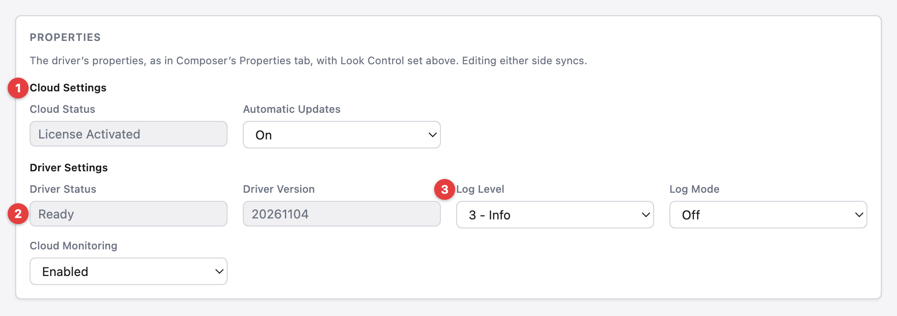
<!-- #else -->
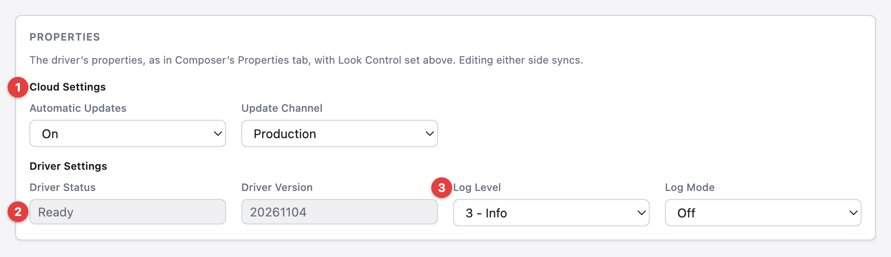
<!-- #endif -->

1. **Cloud Settings** - the driver's [properties](#driver-properties) under the
   same headings as Composer's "Properties" tab. Look Control and the shown look
   are in the Shown now card.
1. **Driver Status** - grayed out, as every read-only property is: the driver
   sets it.
1. **Log Level** - a change applies at once, and shows in Composer's
   "Properties" tab too. A change made there shows here.

<!-- #ifdef DRIVERCENTRAL -->

The Support Code is entered in Composer's "Properties" tab only.

<!-- #endif -->

### Looks

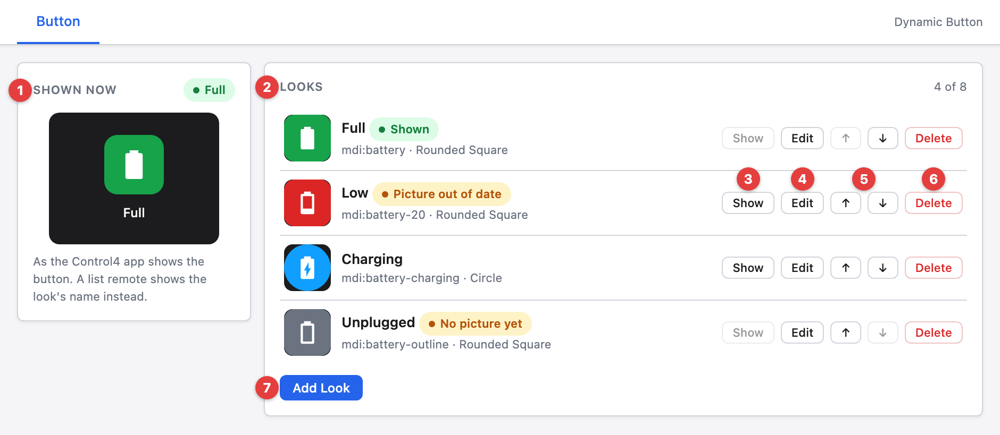

1. **Shown now** - the button as the Control4 app shows it, with the name of the
   look it shows, or `Driver icon` until a look has a picture.
1. **Look Control** - what changes the look. It sets the
   [Look Control](#look-control--on-select--manual--by-value--by-link-)
   property, and a change to the property in Composer shows here.
1. **Looks** - each look with its picture, name, icon and tile shape. `Shown`
   marks the look the button shows. `No picture yet` marks a look whose picture
   has not reached the driver, and `Picture out of date` a look edited since its
   picture was sent: Navigator shows the earlier picture until the look is saved
   again. `Not in cycle` marks a look left out of the cycle.
1. **Show** - shows the look now. It is off for the shown look and for a look
   with no picture.
1. **Edit** - opens the look in the editor.
1. **Duplicate** - opens the editor on a copy of the look, named with the next
   number, and `Save Look` adds it as a new look. It is off when the button has
   eight looks.
1. **↑ / ↓** - moves the look up or down. The button cycles through the looks in
   this order, and programming lists them in it.
1. **Delete** - deletes the look, its picture, its `Shown` event with the
   programming on it, and its Button Link, after a second press on
   `Confirm Delete`. Deleting the shown look shows the first remaining look with
   a picture, or the driver's own icon when none has one. Under `By Value` or
   `By Link`, the look the values or the links call for shows instead.
1. **Add Look** - opens the editor for a new look. A button has up to eight
   looks.

### Look Editor

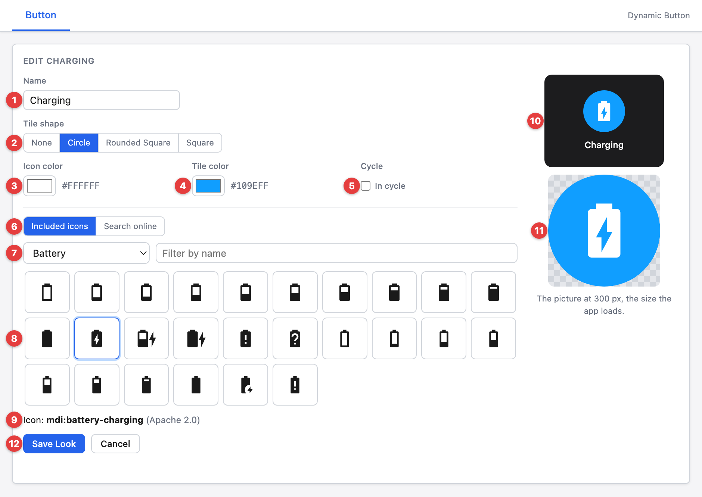

1. **Name** - the look's name in programming: up to 40 characters, without
   commas, and different from the button's other looks. Picking a picture fills
   it in when it is empty.
1. **Tile shape** - `None`, `Circle`, `Rounded Square` or `Square`. With `None`
   the icon is drawn on its own, larger, and `Tile color` is hidden.
1. **Icon color** - the color the icon is drawn in.
1. **Tile color** - the color of the tile behind the icon.
1. **Cycle** - with `In cycle` off, presses, Next Look and Previous Look pass
   over the look. Show Look can still show it.
1. **Timer** - `Stay`, the default, keeps the look until something else changes
   it. `After` shows another look once a set time has passed, as
   [Timed Looks](#timed-looks) describes.
1. **Show while** - shows under `By Link` only: `its link is on` or
   `its link is off`, as [Following a Light](#following-a-light) describes.
1. **Picture** - where the picture comes from: `All included`, the default, one
   of the driver's three icon packs (see [Icon Packs](#icon-packs)),
   `Basic icons`, `Free icon libraries` online (see
   [Free Icon Libraries](#free-icon-libraries)), or `My images`, your own
   pictures (see [My Images](#my-images)). Everything but the libraries works
   with no internet.
1. **All categories** - narrows the pictures to one subject group.
1. **Search pictures** - narrows the pictures by name as you type.
1. **Pictures** - select one to use it for the look.
1. **Search free icon libraries** - looks for the same words in the free icon
   libraries online, when the included pictures don't have what you need.
1. **Icon** - the picked picture and its license.
1. **Preview** - the look as the Control4 app shows it, drawn larger.
1. **Save Look / Cancel** - `Save Look` saves the look and sends its picture to
   the driver. A look renamed without other changes keeps its picture. The
   button's first look shows as soon as its picture arrives.

Every color box opens a picker with the look's own colors and your recent colors
as swatches, a hex box, and hue, saturation and lightness sliders. The picture
changes as you pick, and `Esc` puts the color back.

### Icon

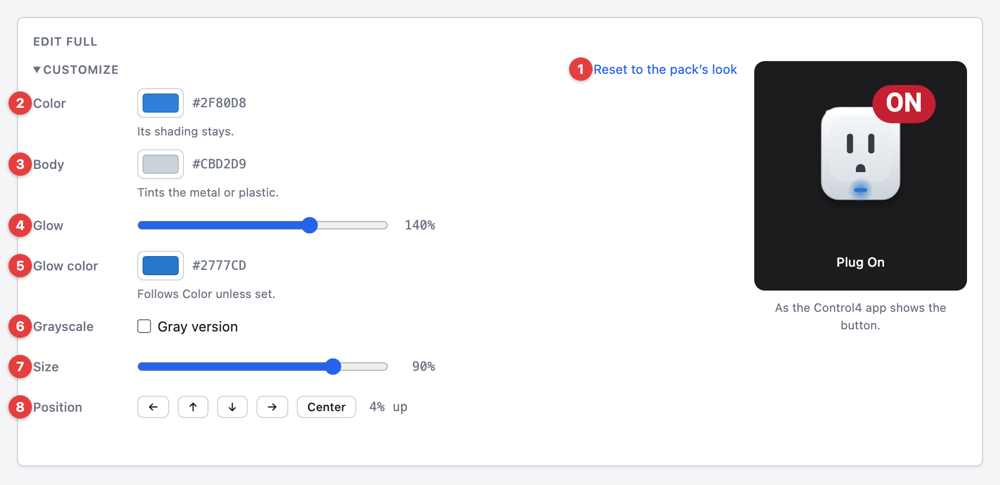

`Icon`, under the picture, changes the look's picture before it is saved. It
shows only what the picked picture can use, and opens by itself on a look that
changes its picture.

1. **Reset to the pack's look** - puts the picture back as it comes: no changes,
   its own glow and in color. The look keeps its badge. For a basic or library
   icon it reads `Reset to the icon's look`, and for one of your own pictures
   `Reset`.
1. **Color** - the picture's color, for a Classic Device or Modern picture. Its
   shading stays, and the charging bolt, the warning mark and the sun keep
   theirs. A Classic Tile picture shows `Tile` and `Symbol` here instead, the
   colors of its tile and its symbol.
1. **Body** - tints the metal or plastic of a Classic Device drawing.
1. **Glow** - the picture's glow, from none through its own at `100%` to twice
   as strong at `200%`. It shows for the Classic Device pictures that glow, and
   is hidden while `Grayscale` is on.
1. **Glow color** - the glow's color. Where the glow belongs to the colored part
   it follows `Color` until set here.
1. **Grayscale** - draws the picture in grays, its tile too, which gives any
   picture a gray version for an off look beside the packs' own on and off
   pictures. A gray picture has no glow, and the look keeps its `Glow` setting
   for when `Grayscale` is turned off again.
1. **Size** - the picture's size, from `50%` to `100%`.
1. **Position** - moves the picture 2% of the picture area at a time, up to 10%
   each way, and stops where a Classic picture's shadow would run out of room.
   `Center` puts it back.

### Badge

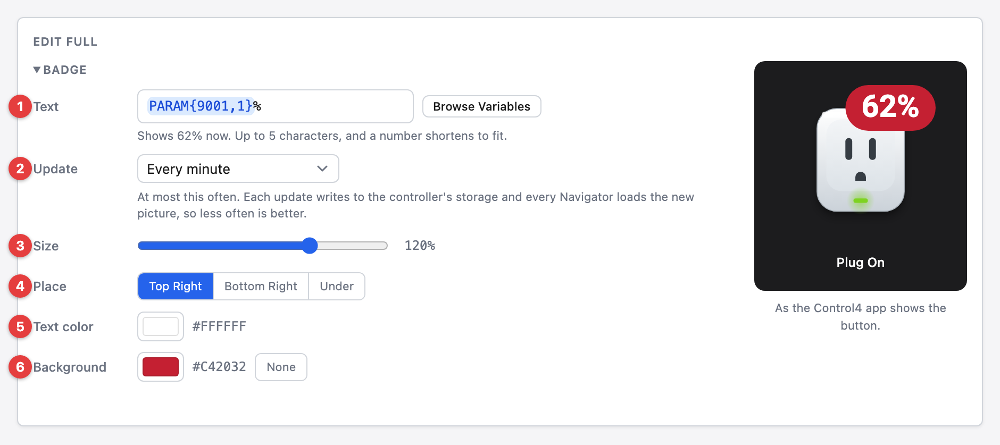

`Badge`, under `Icon`, draws text over the picture. It opens by itself on a look
that has a badge.

1. **Text** - up to 5 characters, or text with a variable's value in it. Empty
   means no badge. `Browse Variables` picks a variable. The controller draws a
   badge with a variable on the shown look and keeps it current. A number gives
   up decimals to fit the 5 characters, and then the end of the text is cut.
   Only English letters, digits, punctuation and the degree sign draw, and other
   characters are left out. While a variable is missing, the look shows no
   badge, and this note and the look's row say why.
1. **Update** - shows when the text holds a variable: `Every 30 seconds`,
   `Every minute`, `Every 5 minutes`, `Every 15 minutes` or `Every hour`. The
   badge changes at most this often, and a change after a quiet spell shows at
   once. Each update writes to the controller's storage and every Navigator
   loads the new picture, so less often is better.
1. **Size** - the badge's size, from `50%` to `150%`.
1. **Place** - `Top Right`, `Bottom Right` or `Under` the picture.
1. **Text color** - the color of the badge's text.
1. **Background** - the badge's color, or `None` for the text alone. A gray
   picture keeps its badge's colors.

### Icon Packs

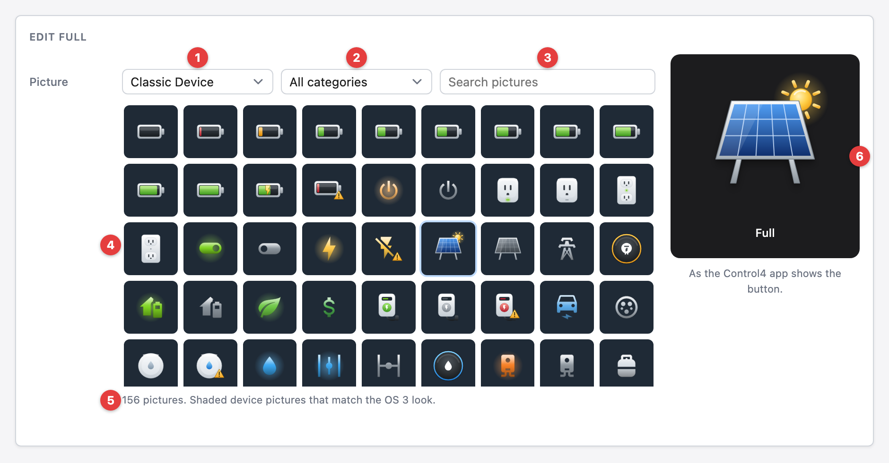

The driver includes three icon packs with the same 100 subjects in each: battery
levels every 10%, power and plugs, energy and solar, EV charging, water and
leaks, air quality, network, generators, pumps and irrigation, pool and spa,
temperature and humidity, devices, appliances, status, home modes, holidays and
weather. A subject with states has a picture for each: on, off and alert where
one applies. They work with no internet.

1. **Classic Device / Classic Tile / Modern** - the pack to show, in the
   `Picture` list. `Classic Device` is shaded device pictures and `Classic Tile`
   is a white symbol on a colored tile, both matching the OS 3 look. `Modern` is
   outline icons when off and filled, colored icons when on, matching the X4
   look. `All included` shows all three with the basic icons.
1. **All categories** - narrows the pictures to one subject group.
1. **Search pictures** - narrows the pictures by name.
1. **Pictures** - select one to use it for the look. The look is named after it
   when the name is empty.
1. **Pack note** - how many pictures show, and what the pack looks like.
1. **Preview** - a pack picture keeps its own colors, so `Tile shape`,
   `Icon color` and `Tile color` are hidden for it. The Classic packs add the
   soft shadow the OS 3 look has. [Icon](#icon) can change its colors.

### Free Icon Libraries

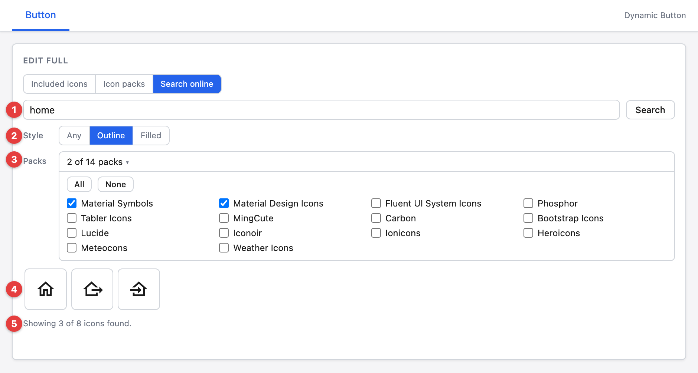

1. **Free icon libraries** - in the `Picture` list: searches free icon libraries
   online, for an icon the included pictures don't have.
1. **Search** - searches the packs chosen under `Packs` for icons whose names
   match the words in the search box, on `Search` or Enter. If the computer
   running Composer cannot reach the icon service, the search goes through the
   controller.
1. **Style** - `Any`, `Outline` or `Filled`. Shows only the outline or the
   filled icons among those found, as each pack marks them in its icon names. An
   icon whose name does not say shows under both. It filters the icons found
   without searching again.
1. **Packs** - the packs to search, all fourteen by default. `All` and `None`
   set every pack at once, and a change searches again.
1. **Icons** - the icons found that match the style. Select one to use it for
   the look.
1. **Icons found** - how many icons the search found, and how many of them the
   style shows.

### My Images

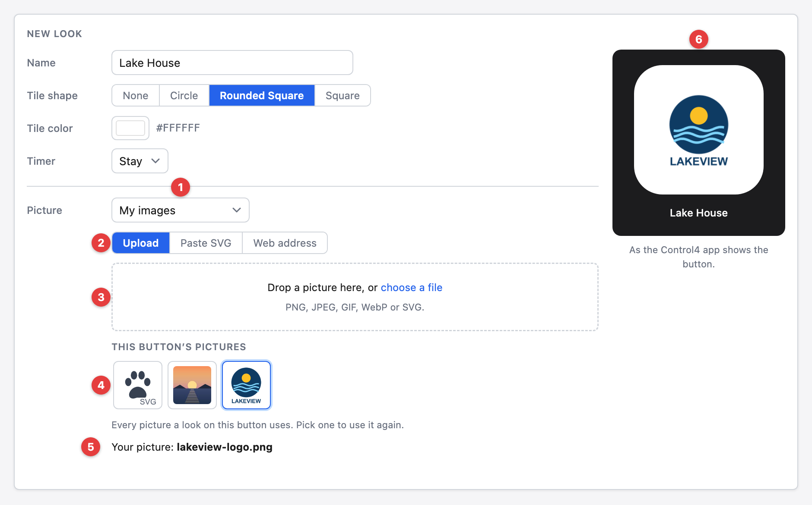

1. **My images** - in the `Picture` list: your own pictures, from a file, pasted
   SVG or a web address.
1. **Upload / Paste SVG / Web address** - how to add a picture.
1. **Upload** - drop a picture on the box, select `choose a file`, or paste a
   picture while `My images` shows. PNG, JPEG, GIF, WebP and SVG work. A picture
   is kept at most 600 px on its long side, as a JPEG when it has no see-through
   parts and as a PNG when it does, and can be at most 512 KB.
1. **This button's pictures** - every picture the button's looks use, and those
   added since the editor opened. Select one to use it again.
1. **Your picture** - the picked picture's file name, or the last part of its
   web address.
1. **Preview** - the look as the Control4 app shows it, drawn larger.

`Paste SVG` takes SVG markup and `Use This SVG` adds it. The SVG needs a
`viewBox`, or a `width` and `height`, and can be at most 64 KB. Scripts, event
handlers, embedded pages and anything loaded from another address are taken out.
An SVG in one color takes the look's `Icon color`, and any other keeps its own
colors.

Except on a picture that refreshes, `Tile shape`, `Tile color`, `Grayscale`,
`Size`, `Position` and the badge work on your pictures as they do on an icon.
`Icon color` shows only for an SVG in one color, and `Glow` never shows.
`Save Look` sends a new picture to the controller before the look. Your pictures
are kept with the button: one that no look uses is deleted 10 minutes after it
was added, and all of them go when the button is deleted or reset.

#### Web Address

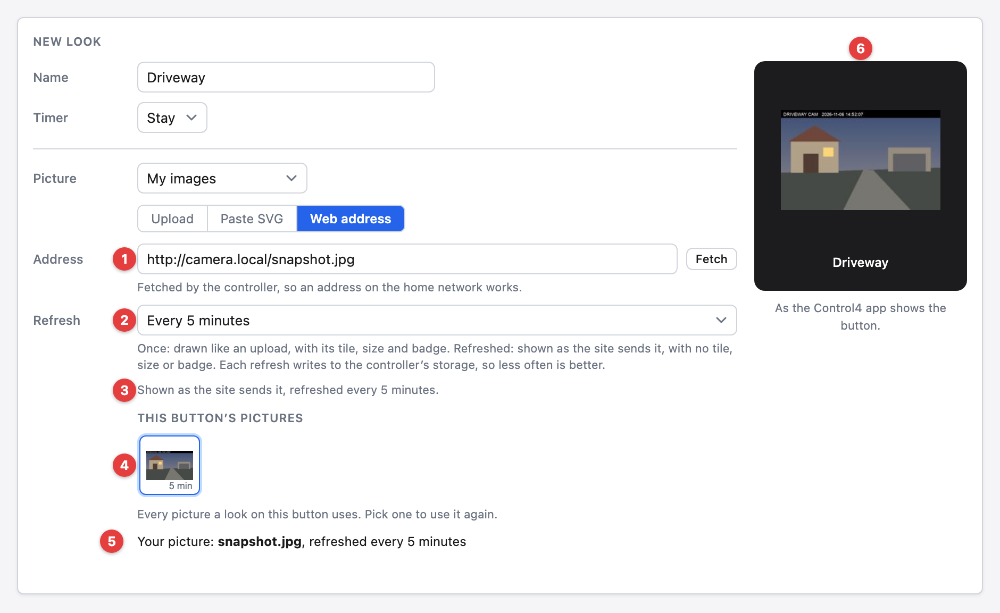

1. **Address** - an http or https address, and `Fetch` adds the picture there.
   The controller fetches it, so an address on the home network works. It can be
   up to 2 MB. A web page, a camera's video stream or anything larger is refused
   as soon as the answer shows it.
1. **Refresh** - what happens to the picture after that:
   - **Once, when saved** - the picture is kept as an uploaded file is, and the
     look keeps it as it was when fetched.
   - **Every minute / Every 5 minutes / Every 15 minutes / Every hour** - the
     controller fetches the address again this often while the look shows, and
     at once when the look shows and its picture is older than that. The
     Control4 app shows the picture as the site sends it, so it has to be a PNG
     or JPEG, and `Tile shape`, the colors, the Icon section and the Badge
     section don't apply. A fetch that brings the same picture changes nothing.
     Each new picture is written to the controller's storage and loaded by every
     Navigator, so less often is better.
1. **Status** - how the fetched picture is kept, or why the fetch failed.
1. **This button's pictures** - a picture that refreshes is tagged with how
   often.
1. **Your picture** - the picture's name and how often it refreshes, and once
   saved, when it last did. A failed refresh keeps the last picture, and the
   look's row and the editor show why it failed.
1. **Preview** - the look as the Control4 app shows it. A picture that refreshes
   shows as the site sends it.

### Copy To, Export and Import

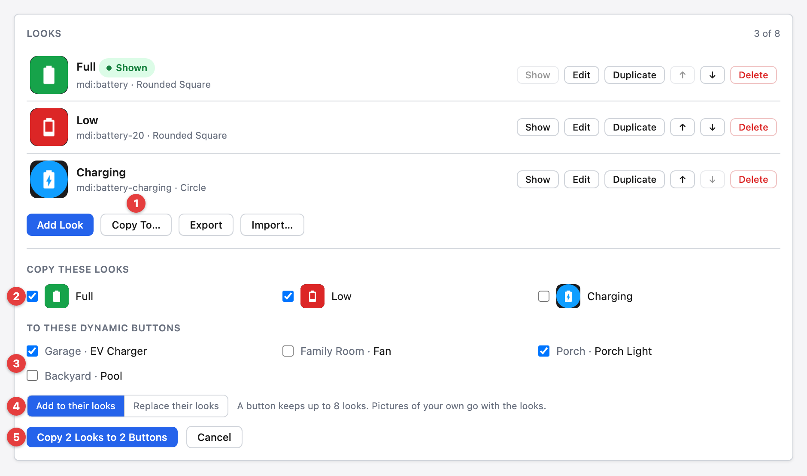

1. **Copy To…** - copies looks to other Dynamic Buttons in this project. It is
   off when the button has no looks or the project has no other Dynamic Button.
1. **Copy these looks** - the looks to copy. All of them are checked to start.
1. **To these Dynamic Buttons** - the buttons to copy them to, by room and name.
1. **Add to their looks / Replace their looks** - `Add` puts the looks after a
   button's own, as many as fit in its eight. `Replace` deletes a button's looks
   first, and the default look among the copies becomes its default. It asks for
   a second press on `Confirm Replace`, since a button's current looks, their
   pictures, the programming on their `Shown` events and their Button Links go.
1. **Copy** - copies to one button after another and shows a line for each: how
   many looks it got, how many didn't fit, and what stopped it.

A copy brings everything a look has but its Button Link connection: its picture,
colors, tile shape, `Cycle`, `Show when`, `Show while`, timer and badge. A timer
whose look isn't copied with it shows the look before, and the button's line
says so. Your own pictures go with the looks and are kept by the other button as
its own, and a picture that refreshes is fetched by the other button from the
same address. A look whose name the other button already uses gets the next
number. A look whose own picture this button no longer has is left out and
named.

<!-- #ifdef DRIVERCENTRAL -->

A button without an active license keeps its looks and gets none.

<!-- #endif -->

`Export` saves the button's looks and your own pictures in one file named after
the button, ending in `.dynamic-button.json`. The file holds the web address of
each picture that refreshes, which can carry a login or token.

#### Import

`Import…` opens such a file. A picture in it goes through the same checks as an
uploaded file or pasted SVG.

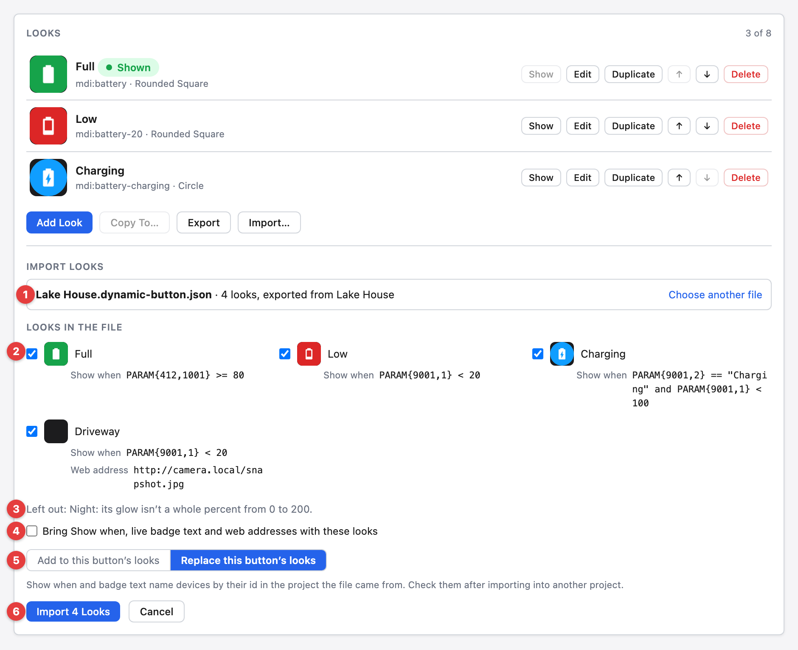

1. **The file** - its name, how many looks it holds, and the button it was
   exported from. `Choose another file` opens another.
1. **Looks in the file** - the looks to import, all checked to start. Under each
   are its `Show when`, a badge's text that holds a variable, and the web
   address of a picture that refreshes.
1. **Left out** - each look the driver would refuse, or that uses an icon this
   driver doesn't have, named with the reason, before anything changes.
1. **Bring Show when, live badge text and web addresses with these looks** -
   starts unchecked, since the controller runs a `Show when` and a badge's
   variable text, and fetches a web address. Unchecked, `Show when` is left
   empty, a badge that holds a variable is left off, and a look whose picture
   refreshes from a web address is left out and named.
1. **Add to this button's looks / Replace this button's looks** - as in
   `Copy To`. `Replace` starts selected here, and asks for `Confirm Replace` the
   same way.
1. **Import** - imports the checked looks into this button and shows how many
   came and which were left out.

`Show when` and badge text name devices by their id in the project the file came
from, so check them after importing into another project.

## Cycling Through Looks

Set the [Look Control](#look-control--on-select--manual--by-value--by-link-)
property to `On Select` to make each press of the button show the next look. The
button steps through the looks in the order the Button tab lists them, wrapping
from the last look back to the first, and passes over a look with **In cycle**
off or with no picture yet. With `Manual`, a press leaves the look as it is and
only programming changes it. With `By Value`, a press also leaves the look as it
is, and each look's expression changes it, as
[Following a Value](#following-a-value) describes. With `By Link`, a press taps
the shown look's link, and the device's reply changes the look, as
[Following a Light](#following-a-light) describes. Show Look, Next Look and
Previous Look work in every mode.

Each look has its own event: the look's name followed by `Shown`. It fires when
that look becomes the shown look, from a press, from programming or from the
Button tab. To run something different for each look:

1. Set **Look Control** to `On Select`.
1. In the "Programming" view, select the button under "Device Events".
1. Select a look's `Shown` event and add the commands it should run.
1. Repeat for each look.

Renaming a look renames its event and keeps its programming. Deleting a look
deletes its event and the programming on it. The shown look stays through a
Director restart and a driver update, and no event fires when the driver starts,
unless the look changes then: a look's timer ran out while the driver was
stopped, or the values or the links call for another look than before. That look
shows as the driver starts, and its events fire.

### Timed Looks

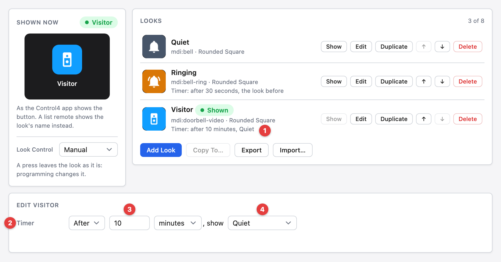

1. **Looks list** - how long a look's timer runs and the look it shows then.
1. **Timer** - `Stay` or `After`.
1. **Time** - from 1 second to 24 hours, in `seconds`, `minutes` or `hours`.
1. **Show** - `the look before`, the look shown just before this one, or another
   look on the button.

A press, programming or the Button tab's `Show` starts a look's timer, and
showing the look again starts it over. Showing another look stops it. When its
time is up, the button shows the chosen look and fires its events as any change
does. If the look before is gone, or there was none, the default look shows, or
else the first look with a picture. Deleting the chosen look turns the timer to
`the look before`. A look a timer shows starts its own timer, so looks can
follow one another, and a chain stops at a look it already showed. The timer
keeps its time through a Director restart and a driver update. A time that runs
out while the driver is stopped takes effect as the driver starts.

Under `By Value`, a look that shows because its Show when is true stays, and its
timer doesn't run. A look that programming or the Button tab shows goes back to
the look the values call for once its time is up, and its Timer row reads
`go back to the values`. Under `By Link` it's the same with the links: the look
goes back to the look the links call for, and its Timer row reads
`go back to the links`.

## Following a Value

Set the [Look Control](#look-control--on-select--manual--by-value--by-link-)
property to `By Value` to make the button's look follow other devices'
variables. Each look gets a **Show when** expression. The first look in the
Button tab's list whose expression is true shows. When none is true, the look
set as the default shows, and with no default the shown look stays.

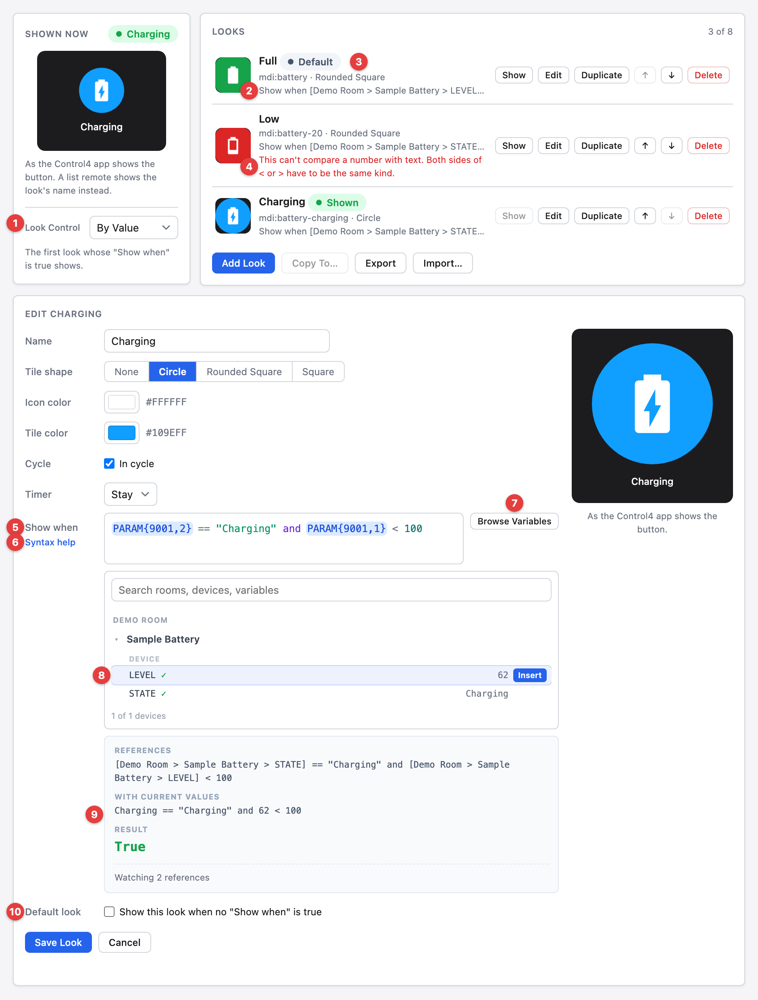

1. **Look Control** - `By Value` shows the rows below, and a press no longer
   changes the look.
1. **Show when** - each look's expression in the list, with device and variable
   names in place of their ids. A look without one only shows as the default or
   from programming.
1. **Default** - marks the look that shows when no expression is true.
1. **Problem** - why a look's expression can't be worked out, in plain words. It
   counts as not true. Hover over it to read the exact message.
1. **Show when** - the look's expression, in color, in the
   [syntax below](#show-when-syntax). Moving a look in the list changes which
   expression is checked first.
1. **Syntax help** - opens a summary of the syntax beside the expression.
1. **Browse Variables** - opens the list of the project's devices, by room.
1. **Variables** - select a device to see its variables and their current
   values, and select a variable to put it in the expression at the cursor. A
   check mark shows the ones the expression already reads.
1. **Preview** - as you type: the expression with device and variable names, the
   same with current values, and a **True** or **False** result, or why it can't
   be worked out. Below that is how many references the look watches.
1. **Default look** - makes this look the default, in place of any other.

Show Look, Next Look, Previous Look and the Button tab's `Show` button still
work. The look they show stays until the expressions call for a different look,
or until its timer is up. That holds through a Director restart and a driver
update.

After a Director restart, other drivers add their variables as they start. For
10 minutes, a look whose variable isn't there yet keeps the button on its
current look, unless a look above it is true. After that, it counts as not true.

### Show When Syntax

An expression gives `true` or `false`. Any other result is reported as a
problem.

| Write                                        | For                                                     |
| -------------------------------------------- | ------------------------------------------------------- |
| `PARAM{device id,variable}`                  | A variable's current value, by its id or its exact name |
| `==` `~=` `<` `<=` `>` `>=`                  | Comparing, where `~=` is not equal                      |
| `and` `or` `not`                             | Combining                                               |
| `+` `-` `*` `/` `%` `^`                      | Arithmetic                                              |
| `"text"`                                     | Text to compare a value with, and it's matched exactly  |
| `abs` `ceil` `floor` `sqrt` `min` `max`      | Math on numbers                                         |
| `pi` `huge`                                  | Pi, and a number larger than any other                  |
| `round(x, places)`                           | Rounding                                                |
| `c2f(x)` `f2c(x)`                            | Converting between Celsius and Fahrenheit               |
| `device_name(id)` `room_name(id)`            | A device's name or room                                 |
| `tonumber` `tostring` `type` `math` `string` | Lua's own functions and libraries of those names        |

A value that is a number or `true` or `false` compares as one. Any other value
compares as text.

## Button Links

Each look has a Button Link connection, named for the look and its number as the
Show Look command lists it. Bind it to a device's On, Off or Toggle button link,
as you would a keypad button. A press of the button in Navigator taps the link
of the look it shows at that moment, then Look Control acts as it does without
one. A look with nothing bound does nothing more on a press. Under `By Link`,
the look also follows what each link's device reports, as
[Following a Light](#following-a-light) describes.

1. Add the look in the Button tab, then refresh Composer (F5) so its connection
   shows.
1. In **Connections**, select the button and bind the look's Button Link to the
   device's link.

Renaming a look renames its connection and keeps it bound. Deleting a look
removes its connection. Copy To, Export and Import bring looks without their
connections: bind the looks again on the other button.

## Following a Light

Set the [Look Control](#look-control--on-select--manual--by-value--by-link-)
property to `By Link` to make the button's look follow the devices its looks'
[Button Links](#button-links) are bound to, as a keypad button's LED does. Each
look gets a **Show while** setting: `its link is on` or `its link is off`. The
first look in the Button tab's list whose link is bound and matches shows. When
none matches, the look set as the default shows, and with no default the shown
look stays.

A press taps the shown look's link, and the look changes only once the device
reports back. A light changed from anywhere else changes the button the same
way. The button asks each device for its state and its LED colors when a look's
link is bound and when the driver starts, so a device that answers shows the
right look at once.

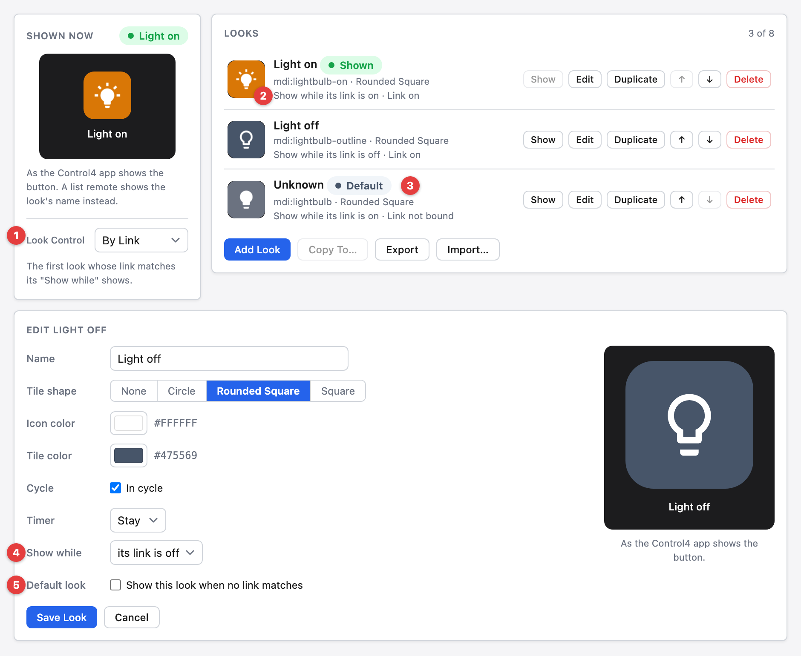

1. **Look Control** - `By Link` shows the rows below.
1. **Link** - each look's Show while, and its link's last state, or `not bound`,
   with the on and off colors its device gives the link, once it has. A look
   with nothing bound, or whose device hasn't reported on the link it's bound
   to, never matches.
1. **Default** - marks the look that shows when no look matches.
1. **Show while** - `its link is on` or `its link is off`. Moving a look in the
   list changes which look is checked first.
1. **Default look** - makes this look the default, in place of any other.

There are two ways to set up a light:

- **One link** - bind both looks to the light's Toggle link. Set "Light on" to
  show while its link is on, and "Light off" while its link is off. A press
  toggles the light, and the button follows.
- **Separate links** - bind "Light off" to the light's On link and "Light on" to
  its Off link, and set both to show while their link is off. The On link is off
  while the light is off, and the Off link is off while the light is on, as a
  keypad's LEDs show. A press taps the link of the look shown, so it switches
  the light, and the button follows.

Show Look, Next Look, Previous Look and the Button tab's `Show` button still
work. The look they show stays until the links call for a different look, or
until its timer is up.

The driver keeps each link's last state through a Director restart and a driver
update, so the button shows the right look before the device next reports. Copy
To, Export and Import bring each look's Show while, but not what its link is
bound to.

## Driver Setup

### Driver Properties

#### Cloud Settings

<!-- #ifdef DRIVERCENTRAL -->

##### Cloud Status (read-only)

Displays the DriverCentral cloud license status.

When the driver has had no active license for five minutes, whether since it
started or since a license or trial ended, Driver Status reads
`No active license` and the button shows the driver's own icon. Until a license
is active, presses, programming, `By Value`, `By Link`, a timer and the Button
tab can't change its look, and Shown Look keeps the name of the look it showed.
The button shows that look again as soon as a license is active.

<!-- #endif -->

##### Automatic Updates \[ Off | **_On_** \]

Turns automatic driver updates on or off. Changing it on one Dynamic Button
changes it on all of them.

<!-- #ifndef DRIVERCENTRAL -->

##### Update Channel \[ **_Production_** | Prerelease \]

Selects which releases the driver installs: `Production` installs releases only,
and `Prerelease` also installs test builds.

<!-- #endif -->

#### Driver Settings

##### Driver Status (read-only)

Displays `Ready` once the driver has started.

##### Driver Version (read-only)

Displays the current version of the driver.

<!-- #ifdef DRIVERCENTRAL -->

##### Log Level \[ 0 - Fatal | 1 - Error | 2 - Warning | **_3 - Info_** | 4 - Debug \]

Sets the logging level. Default is `3 - Info`. While a Support Code has
Composer's Lua tab open, it also offers `5 - Trace` and `6 - Ultra`.

<!-- #else -->

##### Log Level \[ 0 - Fatal | 1 - Error | 2 - Warning | **_3 - Info_** | 4 - Debug | 5 - Trace | 6 - Ultra \]

Sets the logging level. Default is `3 - Info`.

<!-- #endif -->

##### Log Mode \[ **_Off_** | Print | Log | Print and Log \]

Sets the logging mode. Default is `Off`. It turns itself off after three hours.

<!-- #ifdef DRIVERCENTRAL -->

##### Support Code

Leave it blank unless Finite Labs support gives you a code: for an hour, it
opens Composer's Lua tab to this driver and adds `5 - Trace` and `6 - Ultra` to
Log Level.

##### Cloud Monitoring \[ Disabled | **_Enabled_** \]

When Enabled, the driver sends Finite Labs a short report once an hour, and a
report of each error it hits, at most 10 a minute. We use them to find and fix
problems in the driver. Set it to Disabled to send nothing.

A report holds the controller's MAC address and OS version, the driver's name,
version, device ID and DriverCentral license status, how much memory the driver
uses, and the sizes of its largest internal tables. An error report also holds
the error message and where in the driver it happened. Before a message is sent,
anything in it that looks like a password, token, key, network address or email
address is removed.

<!-- #endif -->

#### Button Settings

##### Look Control \[ On Select | **_Manual_** | By Value | By Link \]

Sets what changes the look. `On Select` shows the next look in the cycle on each
press, `Manual` leaves the look for programming to change, `By Value` shows the
first look whose [Show when](#following-a-value) expression is true, and
`By Link` shows the first look whose [Button Link](#following-a-light) is on or
off as its Show while says. The button's own Selected event fires on every press
in every mode.

##### Shown Look (read-only)

Displays the name of the look the button shows, or nothing while it shows the
driver's own icon.

### Driver Actions

<!-- #ifndef DRIVERCENTRAL -->

#### Update Drivers

Installs the latest release on the Update Channel from GitHub for every Dynamic
Button, regardless of the current version.

<!-- #endif -->

#### Reset Driver

> ⚠️ Reset Driver deletes every look, its picture, its `Shown` event with the
> programming on it, and its Button Link. They cannot be brought back.

Returns the driver to a fresh install: it deletes every look with its picture,
its `Shown` event and its Button Link, shows the driver's own icon, and returns
the properties to their defaults, with Look Control back to `Manual`. The update
settings stay as they are, since every Dynamic Button shares them. The button
keeps its place in Navigator and the programming on its other events and
commands. Programming that names a deleted look does nothing, even after a new
look takes the same name: choose the new look in that programming.

**Parameters:**

- **Are You Sure?** \[ **_No_** | Yes \] - Confirmation to reset the driver.

<!-- #ifdef DRIVERCENTRAL -->

#### Diagnostics Snapshot

Prints a report in the Lua output, and sends it to Finite Labs only while Cloud
Monitoring is Enabled.

<!-- #endif -->

## Programming Reference

### Commands

| Command             | Parameters    | Description                                                          |
| ------------------- | ------------- | -------------------------------------------------------------------- |
| Show Look           | Look          | Shows the look on the button, in the cycle or not                    |
| Next Look           |               | Shows the next look in the cycle, wrapping to the first              |
| Previous Look       |               | Shows the previous look in the cycle, wrapping to the last           |
| Refresh Web Picture |               | Fetches the shown look's picture from its web address now            |
| Set Web Address     | Look, Address | Points a look's refreshing picture at another address and fetches it |

Looks show in programming as their name and number. Show Look finds the look by
its number, so programming keeps working after the look is renamed. Next Look
and Previous Look work whatever Look Control is set to.

Refresh Web Picture and Set Web Address work on a look whose picture refreshes
from a web address, and Set Web Address lists only those looks. Set Web Address
takes an http or https address and keeps the look's last picture until the new
address answers with a PNG or JPEG.

### Variables

| Variable | Type   | Description                                                      |
| -------- | ------ | ---------------------------------------------------------------- |
| Look     | STRING | The name of the look the button shows, or empty for its own icon |

### Events

| Event           | Description                                                        |
| --------------- | ------------------------------------------------------------------ |
| Look Changed    | Fires when the button shows a different look                       |
| _\<look>_ Shown | One for each look: fires when that look becomes the shown look     |
| Selected        | The button's own event in Navigator: fires when someone presses it |

### Conditionals

| Conditional | Description                                        |
| ----------- | -------------------------------------------------- |
| Look Is     | Tests whether the button shows a look, or does not |

# Icon Licenses

The included icons and the icon packs are drawn from these collections:

| Collection                                                            | License                                                                                                                                                                    |
| --------------------------------------------------------------------- | -------------------------------------------------------------------------------------------------------------------------------------------------------------------------- |
| [Material Design Icons](https://github.com/Templarian/MaterialDesign) | [Apache 2.0](https://www.apache.org/licenses/LICENSE-2.0)                                                                                                                  |
| [Material Symbols](https://github.com/google/material-design-icons)   | [Apache 2.0](https://www.apache.org/licenses/LICENSE-2.0)                                                                                                                  |
| [Lucide](https://github.com/lucide-icons/lucide)                      | [ISC](https://github.com/lucide-icons/lucide/blob/main/LICENSE), and [MIT](https://github.com/feathericons/feather/blob/main/LICENSE) for its icons that come from Feather |
| [Tabler Icons](https://github.com/tabler/tabler-icons)                | [MIT](https://github.com/tabler/tabler-icons/blob/main/LICENSE)                                                                                                            |

The Classic Device pictures are our own drawings, most built around a Material
Design Icons symbol. The Classic Tile pictures use Material Design Icons
symbols, and the Modern pictures use Lucide, Tabler Icons and Material Design
Icons symbols. A badge's text is drawn in
[Roboto](https://github.com/googlefonts/roboto), under the
[Apache 2.0](https://www.apache.org/licenses/LICENSE-2.0) license, and a badge
with a variable is compressed with
[LibDeflate](https://github.com/SafeteeWoW/LibDeflate), under the
[zlib](https://www.zlib.net/zlib_license.html) license. The driver includes
these notices and the full license texts in its `LICENSES.txt` file.

**Free icon libraries** uses the free [Iconify](https://iconify.design) service
and offers only these packs, whose licenses allow their icons to be used without
credit on each one:

| Pack                   | License                                                       |
| ---------------------- | ------------------------------------------------------------- |
| Material Symbols       | [Apache 2.0](https://github.com/google/material-design-icons) |
| Material Design Icons  | [Apache 2.0](https://github.com/Templarian/MaterialDesign)    |
| Fluent UI System Icons | [MIT](https://github.com/microsoft/fluentui-system-icons)     |
| Phosphor               | [MIT](https://github.com/phosphor-icons/core)                 |
| Tabler Icons           | [MIT](https://github.com/tabler/tabler-icons)                 |
| MingCute               | [Apache 2.0](https://github.com/Richard9394/MingCute)         |
| Carbon                 | [Apache 2.0](https://github.com/carbon-design-system/carbon)  |
| Bootstrap Icons        | [MIT](https://github.com/twbs/icons)                          |
| Lucide                 | [ISC](https://github.com/lucide-icons/lucide)                 |
| Iconoir                | [MIT](https://github.com/iconoir-icons/iconoir)               |
| Ionicons               | [MIT](https://github.com/ionic-team/ionicons)                 |
| Heroicons              | [MIT](https://github.com/tailwindlabs/heroicons)              |
| Meteocons              | [MIT](https://github.com/basmilius/weather-icons)             |
| Weather Icons          | [OFL 1.1](https://github.com/erikflowers/weather-icons)       |

Each look keeps the name and license of the icon it was drawn from.

<!-- #ifdef DRIVERCENTRAL -->

# Developer Information

Copyright © 2026 Finite Labs LLC

All information contained herein is, and remains the property of Finite Labs LLC
and its suppliers, if any. The intellectual and technical concepts contained
herein are proprietary to Finite Labs LLC and its suppliers and may be covered
by U.S. and Foreign Patents, patents in process, and are protected by trade
secret or copyright law. Dissemination of this information or reproduction of
this material is strictly forbidden unless prior written permission is obtained
from Finite Labs LLC. For the latest information, please visit
https://drivercentral.io/platforms/control4-drivers/utility/dynamic-buttons

<!-- #endif -->

# Support

<!-- #ifdef DRIVERCENTRAL -->

If you have any questions or issues integrating this driver with Control4, you
can contact us at
[driver-support@finitelabs.com](mailto:driver-support@finitelabs.com) or
call/text us at [+1 (949) 371-5805](tel:+19493715805).

<!-- #else -->

If you have any questions or issues integrating this driver with Control4, you
can file an issue on GitHub:

https://github.com/finitelabs/control4-dynamic-buttons/issues/new

<!-- #endif -->

<!-- #embed-changelog -->
